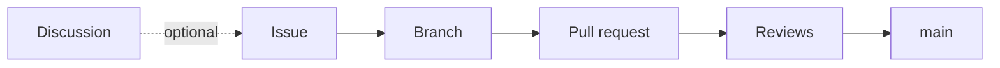

# Contributing

Keep changes small and focused on one issue. Check the [GitHub issues](https://github.com/PRNovoa/software-engineering-database-udit/issues) before starting, and comment on the relevant issue so we avoid duplicate work.

> [!IMPORTANT]
> Larger design decisions can be discussed in [Discussions](https://github.com/PRNovoa/software-engineering-database-udit/discussions) first. It's optional, but useful when the team needs to agree on something before opening an issue for the work.
>
> Follow the design decisions in [docs/design.md](docs/design.md). When a new one is agreed, add it there.

See the [README](README.md) for setup instructions.



## Making changes

- Pick issues by priority: `Must` first, then `Should`, then `Could`.
- Create a branch named `<type>/<issue>-<short-description>`, for example `docs/5-contributing` or `fix/1-create-dictionary`.
- If there's no issue related to what you're going to do add it first.
- Work and push changes on that branch. Never push directly to `main`; changes must go through a pull request.
- Use clear English names and `snake_case` for Python functions and variables. Follow the surrounding code and avoid unrelated refactoring.
- Implement the database logic ourselves and use Python's standard library where possible. Avoid external libraries unless they are necessary, and explain why in the PR.
- Write commits as `<type>: <short description>`. Use `feat`, `fix`, `docs`, `test`, or `chore`, for example `docs: add contributing guide`.
- Keep local environments, generated database files, and credentials out of commits.
- When writing functions specify the types of the parameters that they recieve, as well as their returns.

| Type    | Use it for                                      |
| ------- | ----------------------------------------------- |
| `feat`  | New functionality                               |
| `fix`   | Fixing something that doesn't work as it should |
| `docs`  | Documentation only                              |
| `test`  | Adding or changing tests                        |
| `chore` | Setup, workflow and other maintenance           |

## Issues and labels

### Writing an issue

Title it like a commit: `<type>: <short description>`, for example `fix: validate entries before writing`.

In the body:

1. Say what needs to be done and why, in one or two sentences.
2. List the concrete steps or rules as bullets.
3. Link related issues at the end with `Related to #<number>`. If it can only start after another one, say so: `Once issue #30 is closed...`.

```markdown
Reject entries that cannot be safely stored using the current key:value format.

- Reject ":" in keys.
- Raise ValueError before changing the file or cache.

Related to #3 and #12.
```

If it's a decision to make and not a task, open a Discussion instead (optional), and create the issue once it's agreed.

### Priority labels

Every open issue gets exactly one priority label, following the MoSCoW method:

| Label    | Meaning                                            | When                                                           |
| -------- | -------------------------------------------------- | -------------------------------------------------------------- |
| `Must`   | Required for the project to work.                  | Do these first.                                                |
| `Should` | Important, but the project still works without it. | Do these after the `Must` issues.                              |
| `Could`  | Nice to have.                                      | Do these only once the `Must` and `Should` issues are covered. |

Add the label when you open the issue. If you think a priority is wrong, say so in the issue before you change it.

## Testing

New features and bug fixes must include the relevant tests in the same PR. Update existing tests whenever their expected behaviour changes.

For bug fixes, add a regression test that fails with the original bug and passes with the fix. Tests are part of the change and should not be left for a separate issue afterwards.

Documentation-only changes do not need new tests

## Pull requests

Open a PR with a short description of what changed, why, and how you tested it. Assign yourself to the PR when you open it.

Every PR description must reference its issue using `#` followed by the actual issue number. For example:

| Write            | When                                                            |
| ---------------- | --------------------------------------------------------------- |
| `Closes #31`     | The PR fully resolves the issue.                                |
| `Related to #31` | The PR only covers part of the work or is related to the issue. |

> [!WARNING]
> An issue reference only in the title, branch name, commit message, or comments does not satisfy this requirement.

- Keep `main` production-ready. Merge only completed, tested changes with all automated tests passing.
- All four members must approve the final changes. The PR author confirms approval in a comment; the other three submit approving reviews. If the code changes afterward, everyone must approve again.
- The test and branch-protection setup must run tests on every branch push and pull request, require passing tests and the three other members' reviews before merging, and block direct pushes to `main`, including bypasses.

---

<sub>The formatting and parts of the text were made with AI help. The rules and decisions are our own, agreed by the team.</sub>
