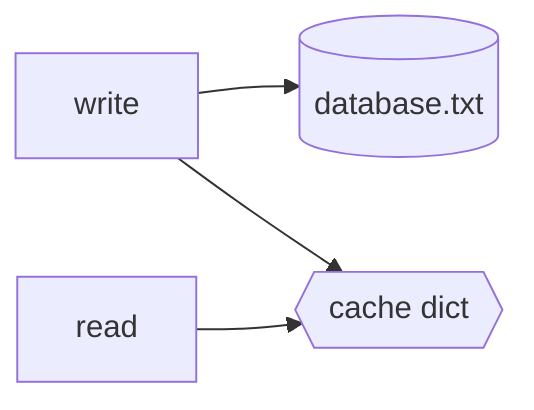

# Design

How the database works and why we did it this way. Each part links to where we decided it.

## The basics

It's a key-value database saved in a text file, one entry per line:

```text
key:value
```

When the program starts we load the whole file into a Python dict, the cache. Reads come from the cache, writes go to both the file and the cache.



> [!NOTE]
> We use Python's dict as is. It's already a hash map and we didn't see the point in writing our own (#2).

## Opening and closing

| Function | What it does | Issue |
|---|---|---|
| `open_db()` | The only function that opens the database file. The rest receive the open `db`. | #1 |
| `close_db()` | Saves pending writes to disk and closes the file. Calling it on an already closed db does nothing. | #38 |
| `start_db()` | Opens the db, cleans it, opens it again and loads the cache. It gives back the db and the cache. | #31, planned in PR #37 |

> [!NOTE]
> `open_db()` opens the file in `a+` mode, so if it doesn't exist it gets created instead of raising.


## Writing: we only append

> [!IMPORTANT]
> We never edit or delete a line in the file, we always add new ones at the end (#8). That way, if the program crashes in the middle, the old data is still there.

| Operation | What we add to the file |
|---|---|
| **Create** | `key:value` |
| **Update** | The key again with the new value. The last line wins. |
| **Delete** | `key:tombstoned`. That value is our tombstone and means the key was deleted (#3). The final value is still open in #51. |

## Cleaning the file

Since we only append, the file keeps growing with old values. `compact_db()` fixes that (#30):

1. Read the file from the bottom up and keep only the last value of each key.
2. Drop the keys whose last value is `tombstoned`.
3. Write the result into a temp file and replace the old one with it.

<table>
<tr><th>Before</th><th>After</th></tr>
<tr><td>

```text
name:alice
age:20
name:bob
age:tombstoned
```

</td><td>

```text
name:bob
```

</td></tr>
</table>

Each record ends with a newline (`\n`). During compaction, an unfinished final record is ignored so the last complete values are preserved. If compaction fails, the original database stays unchanged (#68).

> [!TIP]
> This runs when the database starts (#31), not after every write, so we don't have to search the whole file each time.

## Return values and errors

> [!IMPORTANT]
> If "no" is a normal answer, return a value. If something went wrong, raise (#48).

| Function | Returns |
|---|---|
| `entry_exists()` | `True` or `False`. |
| `read_entry()` | The value, or `None` if the key doesn't exist. |
| `update_entry()` / `delete_entry()` | `True` if they worked and `False` if the key doesn't exist, without touching the file or the cache (#43). |
| Write errors | Raise an exception. |

---

<sub>This document was written and formatted with AI help, based on our issues and discussions. The design decisions and the code are our own work.</sub>
